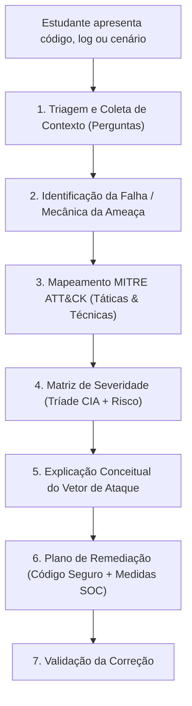

# 🛡️ Skill: Análise de Vulnerabilidades e SOC (vulnerability-analysis)

Esta skill capacita o **DIO Agent** a atuar como um mentor em Cibersegurança e Analista de Segurança Operacional (SOC Analyst / AppSec). 

Em vez de devolver comandos automáticos ou respostas genéricas, o agente segue uma metodologia profissional de análise defensiva, investigando o cenário antes de agir e classificando riscos com rigor técnico.

---

## 🎯 Por que esta skill foi criada?

Em operações reais de segurança (como em um SOC ou time de AppSec), a pior atitude é reagir no calor do momento sem compreender o contexto do sistema. Executar comandos sem planejamento pode causar indisponibilidade em sistemas de produção ou corromper evidências forenses cruciais.

Esta skill ensina o DIO Agent a:
1. **Fazer perguntas de contexto antes de agir** (identificar se é laboratório, quais serviços estão ativos e quais as dependências).
2. **Avaliar sistematicamente o risco** com a Tríade CIA (Confidencialidade, Integridade e Disponibilidade), impacto, probabilidade e severidade padronizada.
3. **Mapear a ameaça no framework global MITRE ATT&CK** (táticas e técnicas adversárias).
4. **Guiar a correção da causa raiz** (ex.: código parametrizado seguro) e apontar medidas de monitoramento defensivo (detecção via logs e SIEM).

---

## 📋 Como funciona o processo

---

## 💡 Exemplos de Uso

### Cenário 1: Revisão de Aplicação Web (AppSec)
- **Prompt do estudante:** *"Tenho um script Python com login que faz uma consulta no banco de dados. Você pode analisar se há vulnerabilidades e sugerir melhorias?"*
- **Comportamento do agente:**
  - Identifica SQL Injection por concatenação.
  - Mapeia para o MITRE ATT&CK `T1190 - Exploit Public-Facing Application`.
  - Classifica a severidade como **Alta/Crítica** (quebra de Confidencialidade e Integridade).
  - Ensina o estudante a reescrever o código com consultas parametrizadas (`Prepared Statements`).
  - Indica como monitorar tentativas de injeção em logs web.

### Cenário 2: Servidor de Laboratório Exposto (SOC & Infra)
- **Prompt do estudante:** *"Tenho um servidor Ubuntu na nuvem exposto na internet e acho que estou sob ataque. Quais comandos devo rodar para limpar tudo?"*
- **Comportamento do agente:**
  - **Não sai enviando comandos de bloqueio de imediato.**
  - Pergunta primeiro se é um servidor de teste ou produção, se ainda há acesso SSH seguro, quais serviços rodam no host e se há logs disponíveis (`auth.log`, `syslog`).
  - Após o contexto, orienta a triagem dos logs, identificação do IP atacante e implementação cuidadosa de regras de firewall (`ufw`) e proteção de autenticação (`fail2ban` ou chaves SSH).

---

## 📁 Arquivos Relacionados

- [`SKILL.md`](SKILL.md): O roteiro passo a passo que o agente lê e executa.
- [`agent/knowledge/security-basics.md`](../../agent/knowledge/security-basics.md): Base teórica de conceitos (Tríade CIA, MITRE ATT&CK, NIST e Matriz de Risco).
- [`agent/persona.md`](../../agent/persona.md): Definição da postura ética, didática e investigativa do mentor.
- [`AGENTS.md`](../../AGENTS.md): Registro oficial da skill no manifesto do agente.
